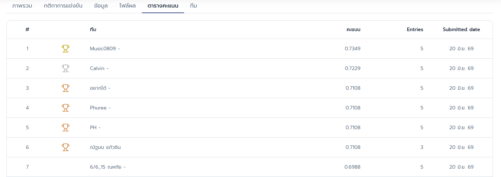

# BDI Khon Kaen Citizen Service Resolution Classification

This repository contains the champion (1st Place) machine learning solution for the BDI Khon Kaen Citizen Service Resolution Classification competition. The final model achieves **0.7349** accuracy on the Leaderboard, securing **1st Place** overall.



## Final Solution Overview
The solution uses a **Stacked Generalization (Stacking)** ensemble of two powerful gradient boosted decision tree frameworks:
- **LightGBM** (Tuned using Optuna)
- **CatBoost** (Tuned using Optuna)

A **Logistic Regression** model is trained on top as the meta-learner to combine out-of-fold (OOF) probabilities from both models.

### Key Preprocessing & Feature Engineering
- **Date Features:** Parsing Thai dates, extracting Year, Month, Day, Day of Week, and Weekend indicators.
- **Interaction Features:** Creating `year_month` and `day_weekend` features to capture seasonal/temporal effects.
- **Text Features (TF-IDF + SVD):** Running TF-IDF on the complaint description (`เรื่องร้องทุกข์`) and reducing it to 10 components using TruncatedSVD to capture latent topics.
- **Categorical Columns:** Standard categorical encoding for departments, districts, and complaint types.

---

## 📁 Repository Structure
```
├── dataset/                     # Training & Test CSV files (ignored by git)
├── submissions/                 # Submission CSV outputs (ignored by git)
├── diagnostics/                 # Temporary script files used during research & testing
│
├── eda.py                       # Exploratory Data Analysis
├── train.py                     # Baseline LightGBM classifier script
├── tune.py                      # Optuna hyperparameter optimization script
├── final_pipeline.py            # Main script to reproduce the final 0.7349 stacked model
│
├── requirements.txt             # Python dependencies
├── .gitignore                   # Excluded files list
└── README.md                    # Project documentation
```

---

## 🛠️ Installation & Reproduction

1. **Set up virtual environment:**
   ```bash
   python -m venv venv
   .\venv\Scripts\activate      # Windows Powershell
   ```

2. **Install requirements:**
   ```bash
   pip install -r requirements.txt
   ```

3. **Run Exploratory Data Analysis:**
   ```bash
   python eda.py
   ```

4. **Reproduce Final Submission:**
   Run the final pipeline script to perform Stratified 5-Fold training, meta-learning, and generate the final submission file:
   ```bash
   python final_pipeline.py
   ```
   The final predictions will be generated at `submissions/final_solution_submission.csv`.

---

**Developed for the Khon Kaen Citizen Service Resolution Classification.**
